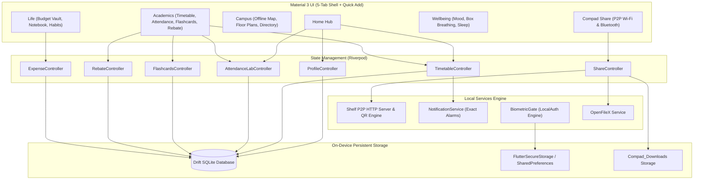

# Compad — Autonomous Offline-First Campus Companion

<p align="center">
  
</p>

<p align="center">
  
  
  
  
  
  
  
</p>

> **Compad** is a production-grade, 100% offline-first student companion mobile application engineered for higher education campuses. Operating with zero mandatory cloud dependencies or constant internet connectivity, Compad ensures students maintain uninterrupted access to schedules, attendance tracking, safe-bunk simulations, financial budgeting, flashcards, hostel rebates, and high-speed peer-to-peer file transfers — even inside zero-connectivity basement labs, crowded lecture halls, and network dead zones.

---

## 📌 Hackathon Project Overview

- **Event:** [TechSpace BuildLab ’26](https://buildlab-techspace-2026.vercel.app/)
- **Track:** Advanced — Squad
- **Problem Statement ID:** **A08** ([Offline-first Campus Companion App](https://buildlab-techspace-2026.vercel.app/projects/advanced?project=a08))
- **Team Name:** **Matrix**
- **Repository:** [github.com/jitin-s/Compad](https://github.com/jitin-s/Compad)

---

## ⚠️ The Real Campus Problem

College campuses suffer from frequent network friction:
1. **Basement & Concrete Dead Zones:** Engineering labs, libraries, and tiered lecture halls frequently have zero cellular reception.
2. **Wi-Fi Congestion & Captive Portals:** Campus Wi-Fi routers frequently disconnect or require repeated portal logins, leaving students stranded right when they need to check lecture halls or submit documents.
3. **Cloud-Dependent App Fragility:** Traditional campus apps crash, hang on infinite loading spinners, or wipe state when launched offline.
4. **Data Privacy & Surveillance:** Centralized systems collect unnecessary student telemetry and lock students into proprietary institutional silos.

---

## 💡 The Compad Solution: 100% Air-Gapped Autonomy

Compad replaces fragile cloud connections with **autonomous on-device storage** and **peer-to-peer ad-hoc meshes**:
- **Zero Cloud Dependence:** Complete local SQLite database with persistent storage across reboots and app updates.
- **Universal Student Identity Chip:** One-time on-device setup with QR code identity key; works universally across any college or university with no institutional lock-in.
- **Offline P2P Compad Share (QR Key + Wi-Fi Hotspot & Bluetooth):** Beam any document or campus dataset directly to peers with zero internet access. Shows file save path and offers a direct **Open File** action.
- **75% Attendance Lab & Safe-Bunk Simulator:** Calculate attendance deficits, simulate future bunks, and enter baseline records with live percentage recalculation.
- **Spaced Repetition Flashcards:** Offline Leitner / SM-2 algorithm for exam preparation with 3D flip card viewer and deck creation.
- **Hostel & Mess Rebate:** Log leaves, compute mess bill rebates, and track rebate approvals offline.
- **Student Budget Vault & UPI Payments:** Track spending and launch instant UPI app payments.
- **Hardware Biometric Lock:** Fingerprint and Face ID protection with persistent state.
- **Material 3 Design System:** Modern Indigo/Teal aesthetic with accessible touch targets, responsive light/dark modes, and smooth animations.

---

## 🚀 Key Feature Modules

### 1. ⚡ Offline P2P Compad Share (Any Document & Campus Data)
- **Universal File Transfer:** Beam any file from device storage (PDFs, PPTs, notes, images, DOCX, ZIPs) or campus data packages (`.campack`).
- **QR Connection Key & Local HTTP Server:**
  - **Wi-Fi Direct / Hotspot Streaming:** Sender spins up an embedded local Shelf HTTP server; receiver scans the pairing QR code to initiate high-speed local transfer.
  - **All Topologies Supported:** Works if sender is Hotspot host, receiver is connector, or both share a local router without internet.
  - **Browser Fallback:** Receiver can download files directly in Chrome/Safari using `http://<ip>:<port>`.
- **Open File Action & Path Display:** Displays exact local storage path (`/storage/emulated/0/Download/Compad_Downloads/`) and features a 1-tap **"Open File"** button powered by `open_filex`.
- **Bluetooth Air-Share:** Zero-configuration Bluetooth fallback when Wi-Fi is unavailable.

### 2. 🔬 Attendance Lab & Safe-Bunk Simulator
- **Aggregated Health Dial:** Real-time percentage indicator with automatic Safe Zone ($\ge 75\%$) and Deficit Zone calculations.
- **Direct Attendance Entry Options:**
  - **Direct Baseline Entry:** Enter baseline numbers (e.g., Attended: 24, Held: 30) with live percentage preview.
  - **Single Class Logger:** Log today's lectures as Present, Absent, or Cancelled.
- **Safe-Bunk Simulator Core:** Interactive slider simulates future missed lectures and computes exact classes needed to recover above the 75% threshold.
- **Medical Exemption Toggle:** Dynamically computes how medical leave flags protect attendance buffers.

### 3. 🗂️ Spaced Repetition Flashcards (Leitner / SM-2)
- **Interactive 3D Flip Card Viewer:** Test active recall with smooth flip animations.
- **Adaptive Spaced Repetition:** Implements Leitner / SM-2 intervals based on student confidence ratings (Again, Hard, Good, Easy).
- **Deck & Card Manager:** Add custom decks, input new flashcard question/answer pairs, and review due cards completely offline.

### 4. 🏢 Hostel & Mess Rebate Manager
- **Leave Logger:** Log upcoming hostel absence dates and reasons.
- **Rebate Calculation:** Automatically calculates per-day mess rebate amount based on registered leave duration.
- **Status Tracker:** Track rebate submission status (Pending, Approved, Credited) with local persistence.

### 5. 📅 Master Timetable Matrix & Class Notifications
- **Course & Slot Manager:** Organize subjects with custom hex color identifiers, room assignments, and faculty tags.
- **Interactive Day Selector:** View daily session rosters with time ranges and active class hero cards.
- **Class Reminders:** Local background notifications trigger **10 minutes before every scheduled lecture**.

### 6. 💰 Student Expense Vault & UPI Payments
- **Offline Budgeting:** Track daily expenses across categories: *Food & Dining, Stationery, Transit, Books & Notes, Fees, Personal, Other*.
- **UPI Instant Pay:** Deep-link intent launcher for Google Pay, PhonePe, and Paytm.

### 7. 🗓️ Academic Calendar & Activity Tagging
- **Interactive Month Matrix:** Monthly calendar view with indicator dots on days with deadlines.
- **Activity Tags:** Tag and manage upcoming *Exams, Assignment Submissions, Viva / Lab Assessments, Campus Fests, and Deadlines*.

### 8. 🗺️ Offline Campus Map & Indoor Directions
- **Vector Maps:** Embedded vector map viewer with building pins and search.
- **Indoor Floor Plans & A* Routing:** Step-by-step walking directions calculated locally without GPS or cellular data.

### 9. 🧘 Wellbeing & Daily Habits
- **Daily Mood Tracker:** Daily emotional check-in with streak tracking.
- **Guided Box Breathing:** Calming 4-4-4-4 visual breathing pacing for exam stress relief.
- **Sleep & Nutrition Logs:** Track daily sleep hours and water intake.

---

## 🏗️ System Architecture



---

## 🔒 Security & Privacy Model

- **Zero Remote Telemetry:** Compad transmits zero tracking data, device analytics, or usage statistics to any external servers.
- **Deterministic Storage:** Backed by Drift SQLite and persistent keystores; user data survives app termination and device restarts.
- **Air-Gapped P2P Encryption:** Local Wi-Fi transmissions occur directly between device endpoints using isolated ephemeral sockets and QR pairing keys.

---

## 📱 Installation & Getting Started

### Method 1: Build from Source (Flutter)
Ensure you have Flutter SDK (`>= 3.3.0`):

```bash
# Clone the repository
git clone https://github.com/jitin-s/Compad.git
cd Compad/compad

# Install dependencies
flutter pub get

# Run test suite (All 44 unit & widget tests)
flutter test

# Run on connected device or emulator
flutter run

# Build production Android APK
flutter build apk --release
```

The release APK will be generated at `compad/build/app/outputs/flutter-apk/app-release.apk`.

### Method 2: Build for iPhone (iOS)
Compad is fully equipped with iOS permissions, AppIcon assets, and CocoaPods configurations:
- **Automated Cloud Build:** Run the [**GitHub Actions iOS Workflow**](.github/workflows/build_ios.yml) to generate `compad-iphone-release.ipa` on a free Apple Silicon macOS runner.
- **Local Mac Build:**
  ```bash
  chmod +x build_ios.sh
  ./build_ios.sh
  ```

---

## 🛠️ Tech Stack & Dependencies

| Layer | Technologies |
|---|---|
| **Framework** | Flutter 3.x (Dart 3.x, null-safe) |
| **State Management** | Riverpod (`StateNotifierProvider`) |
| **Database & Security** | Drift SQLite, `flutter_secure_storage`, `local_auth` |
| **P2P Networking** | Shelf HTTP server, `mobile_scanner`, `qr_flutter`, `share_plus` |
| **File Handling** | `file_picker`, `path_provider`, `open_filex` |
| **Notifications** | `flutter_local_notifications` (Android exact alarm channels) |
| **Styling & Icons** | Material 3 Design System, `lucide_icons_flutter`, `google_fonts` |

---

## 👥 Team Matrix

| # | Name | Year / Program | Role / Focus |
|---|------|----------------|--------------|
| 1 | **Jitin Sain** | 1st Year / B.Tech CSE-AIML | Team Lead / Mobile Architecture & Sync |
| 2 | **Yash Malik** | 1st Year / B.Tech CSE-AIML | Frontend / Flutter UI & State Management |
| 3 | **Kartik Maan** | 1st Year / B.Tech CSE-AIML | Frontend / UI Components & Client Integration |
| 4 | **Vansh** | 1st Year / B.Tech CSE-AIML | Backend / Node.js API & Database Engineering |

Developed with passion by **Team Matrix** for **TechSpace BuildLab ’26** (Problem Statement **A08**).

- **License:** MIT License
