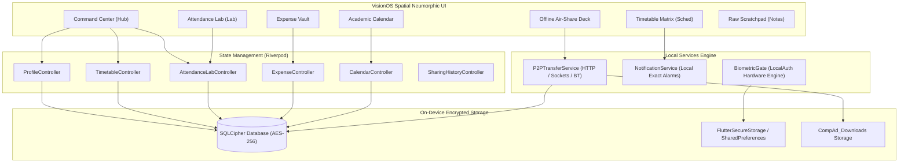

# CompAd — Autonomous Offline-First Campus Companion Matrix

<p align="center">
  
</p>

<p align="center">
  
  
  
  
  
  
  
</p>

> **CompAd** is an autonomous, 100% offline-first student companion mobile application engineered for higher education campuses. Operating with zero mandatory server dependencies or internet connectivity, CompAd ensures that students maintain uninterrupted access to schedules, attendance telemetry, academic deadlines, financial budgeting, and high-speed device-to-device file transfers — even inside zero-connectivity basement labs, crowded lecture halls, and network dead zones.

---

## 📌 Hackathon Project Overview

- **Event:** [TechSpace BuildLab ’26](https://buildlab-techspace-2026.vercel.app/)
- **Track:** Advanced — Squad
- **Problem Statement ID:** **A08** ([Offline-first Campus Companion App](https://buildlab-techspace-2026.vercel.app/projects/advanced?project=a08))
- **Team Name:** **Matrix**
- **Repository:** [github.com/jitin-s/compad](https://github.com/jitin-s/compad)
- **Direct Release Download:** [**CompAd Releases (APK)**](https://github.com/jitin-s/compad/releases) (ARM64 & Universal builds)

---

## ⚠️ The Real Campus Problem

College campuses are infamous for severe network friction:
1. **Basement & Concrete Dead Zones:** Engineering labs, libraries, and tiered lecture halls frequently have zero cellular reception.
2. **Wi-Fi Congestion & Captive Portals:** Campus Wi-Fi routers frequently disconnect or require repeated portal logins, leaving students stranded right when they need to check class locations or submit documents.
3. **Cloud-Dependent App Fragility:** Traditional campus apps crash, hang on infinite loading spinners, or wipe user state when launched offline.
4. **Data Privacy & Surveillance:** Centralized systems collect excessive telemetry and lock students into proprietary institutional silos.

---

## 💡 The CompAd Solution: 100% Air-Gapped Autonomy

CompAd replaces fragile cloud connections with **autonomous on-device intelligence** and **peer-to-peer ad-hoc meshes**:
- **Zero Cloud Dependence:** Complete local SQLite database with AES-256 encryption via SQLCipher.
- **Universal Student Identity Chip:** One-time on-device setup with QR code identity key; works universally across any college or university with no institutional lock-in.
- **Offline P2P Air-Share (QR Key + Wi-Fi & Bluetooth):** Beam any document or campus dataset directly to peers with zero internet access.
- **Tactile Safe-Bunk Simulator:** Predict bunk capacities and recovery trajectories with mathematical precision.
- **Hardware-Level Biometric Lock:** Fingerprint and Face ID protection with persistent state across app restarts.
- **Spatial Neumorphic UI:** VisionOS-inspired design with tactile physical depths, specular lighting, and fluid responsiveness.

---

## 🚀 Key Feature Modules

### 1. ⚡ Offline P2P Air-Share Mesh (Any Document & Campus Data)
- **Universal File Transfer:** Beam any file from device storage (PDFs, PPTs, notes, images, DOCX, ZIPs) or campus data packages (timetables, scratchpads).
- **QR Connection Key:**
  - **Wi-Fi Direct / Hotspot Streaming:** Sender spins up an embedded local HTTP server; receiver connects via CompAd camera scanner or any web browser.
  - **All Topologies Supported:** Works if sender is Hotspot host, receiver is connector, or both are connected to a common local Wi-Fi router **without internet**.
  - **Fallback Browser URL:** Receiver can simply open `http://<local_ip>:<port>` in Chrome/Safari to download files without installing the app.
- **Open File Action & Path Display:** Displays exact local path (`/storage/emulated/0/Download/CompAd_Downloads/`) and features a 1-tap **"Open File Now"** viewer powered by `open_filex`.
- **Bluetooth Air-Share:** Direct zero-configuration fallback via Bluetooth.
- **Anonymous Identity Mode:** Toggle between verified student credentials and anonymous broadcast.

### 2. 🔬 Attendance Lab & Safe-Bunk Simulator
- **Aggregated Health Dial:** Real-time percentage indicator with automatic Safe Zone ($\ge 75\%$) and Deficit Zone calculations.
- **Direct Attendance Entry Option:**
  - **Direct Numbers Entry:** Enter exact baseline numbers (e.g. Attended: 24, Held: 30) with live percentage preview.
  - **Single Class Logger:** Log today's lectures as Present, Absent, or Cancelled.
- **Safe-Bunk Simulator Core:** Interactive slider simulates future missed lectures and computes exact classes needed to recover above the 75% threshold.
- **Medical Exemption Toggle:** Dynamically computes how medical leave flags protect attendance buffers.

### 3. 📅 Master Timetable Matrix & Smart Class Notifications
- **Course & Slot Manager:** Organize subjects with custom hex color identifiers, room assignments, and faculty tags.
- **Interactive Day Selector:** View daily session rosters with time ranges and active class hero cards.
- **Automatic Class Reminder Notifications:** Local background notifications trigger **10 minutes before every scheduled lecture**, keeping students on track without draining battery.

### 4. 💰 Student Expense Manager (Expense Vault)
- **Offline Budgeting:** Track daily expenses across 7 categories: *Food & Dining, Stationery, Transit, Books & Notes, College Fees, Personal, and Other*.
- **Tactile Budget HUD:** Visual monthly budget bar with threshold warnings and category breakdowns.

### 5. 🗓️ Academic Calendar & Activity Tagging
- **Interactive Month Matrix:** Monthly calendar view with indicator dots on days with deadlines.
- **Activity Tags:** Tag and manage upcoming *Exams, Assignment Submissions, Viva / Lab Assessments, Campus Fests, and Registration Deadlines*.

### 6. 📝 Dev Scratchpad & Raw Notes
- **Local Markdown Engine:** Write study notes, lab commands, and code snippets with live syntax highlighting and persistent local storage.

---

## 🏗️ System Architecture



---

## 🔒 Security & Privacy Model

- **Deterministic Key Architecture:** Backed by persistent key storage; database state is strictly preserved and never lost on app termination.
- **No Remote Telemetry:** CompAd transmits zero tracking data, device analytics, or usage statistics to any external servers.
- **Air-Gapped P2P Encryption:** Local Wi-Fi transmissions occur directly between device endpoints using isolated ephemeral sockets.

---

## 📱 Installation & Getting Started

### Method 1: Direct Android Installation (Ready to Test)
Download the pre-compiled APK directly from the repository:
- [**Download `compad-mobile-arm64.apk`**](compad-mobile-arm64.apk) (56.2 MB) — Optimized for modern 64-bit Android devices.

### Method 2: Build from Source (Flutter)
Ensure you have the Flutter SDK installed (`>= 3.3.0`):

```bash
# Clone the repository
git clone https://github.com/jitin-s/compad.git
cd compad/comp_ad

# Install dependencies
flutter pub get

# Run on connected device / emulator
flutter run --release

# Build production Android APK
flutter build apk --release --target-platform android-arm64
```

### Method 3: Build for iPhone (iOS)
CompAd is fully equipped with iOS permissions, AppIcon assets, and CocoaPods configurations:
- **Automated Cloud Build:** Run the [**GitHub Actions iOS Workflow**](.github/workflows/build_ios.yml) to generate `compad-iphone-release.ipa` on a free Apple Silicon macOS runner.
- **Local Mac Build:**
  ```bash
  chmod +x build_ios.sh
  ./build_ios.sh
  ```

---

## 🛠️ Tech Stack & Dependencies

| Layer | Technologies |
|---|---|
| **Framework** | Flutter 3.x (Dart 3.x) |
| **State Management** | Riverpod 2.5 (`StateNotifierProvider`) |
| **Database & Security** | `sqflite_sqlcipher` (AES-256), `flutter_secure_storage`, `local_auth` |
| **P2P Networking** | `dart:io` `HttpServer`, `mobile_scanner`, `qr_flutter`, `share_plus` |
| **File Handling** | `file_picker`, `path_provider`, `open_filex` |
| **Notifications** | `flutter_local_notifications` (Android exact alarm channels) |
| **Styling & Icons** | Spatial Neumorphic Design System, `lucide_icons_flutter`, `google_fonts` |

---

## 👥 Team Matrix
### Team Members

| # | Name | Year / Program | Role / Focus |
|---|------|----------------|--------------|
| 1 | **Jitin Sain** | 1st Year / B.Tech CSE-AIML | Team Lead / Mobile Architecture & Sync |
| 2 | **Yash Malik** | 1st Year / B.Tech CSE-AIML | Frontend / Flutter UI & State Management |
| 3 | **Kartik Maan** | 1st Year / B.Tech CSE-AIML | Frontend / UI Components & Client Integration |
| 4 | **Vansh** | 1st Year / B.Tech CSE-AIML | Backend / Node.js API & Database Engineering |
Developed with passion by **Team Matrix** for **TechSpace BuildLab ’26** (Problem Statement **A08**).

- **Project Lead & Architecture:** Team Matrix
- **License:** MIT License
